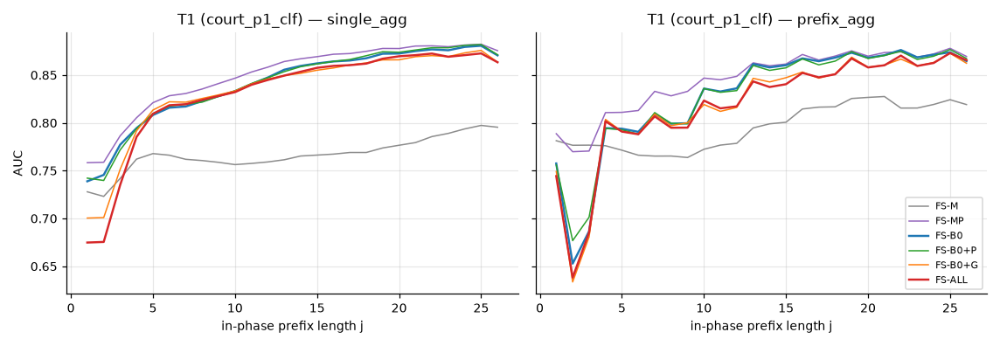
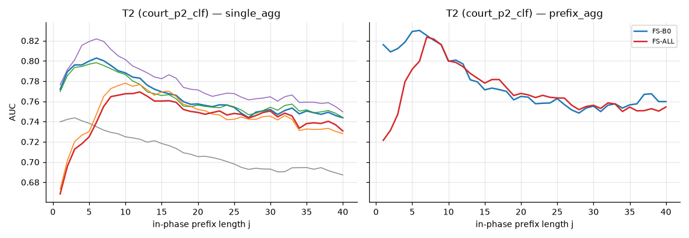
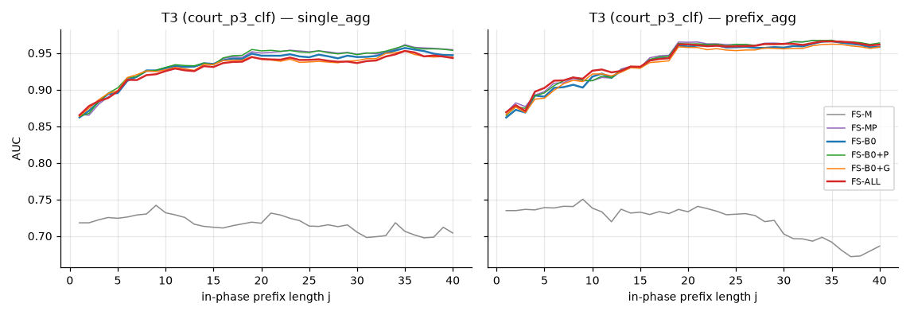
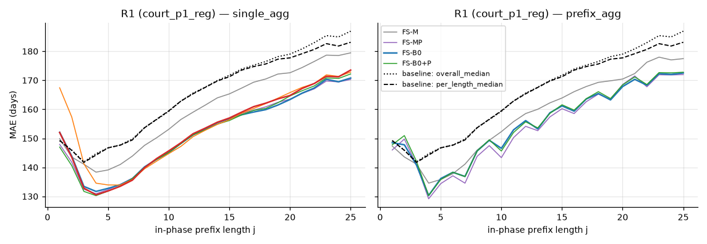
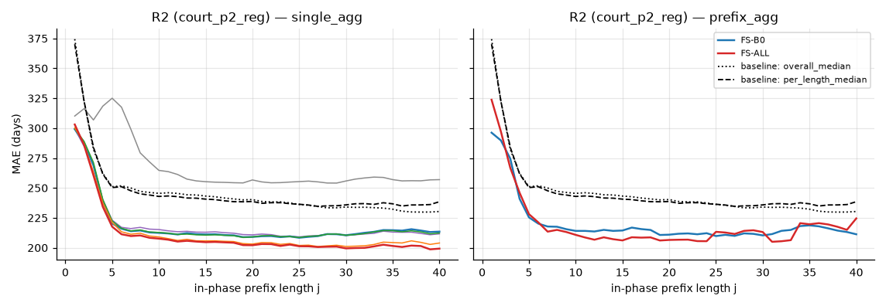
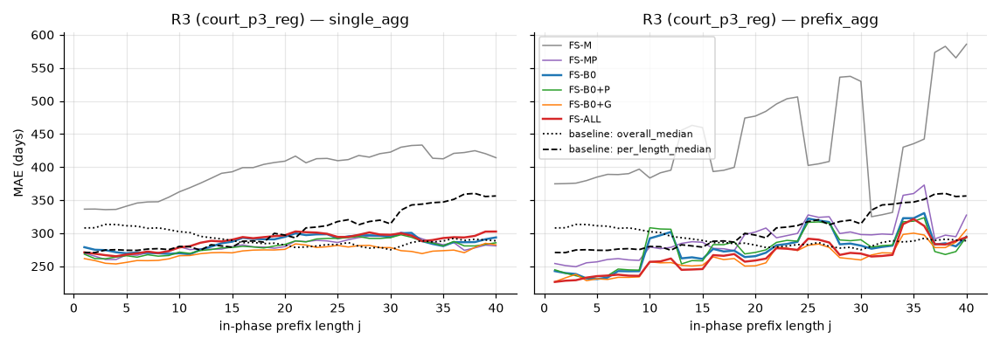
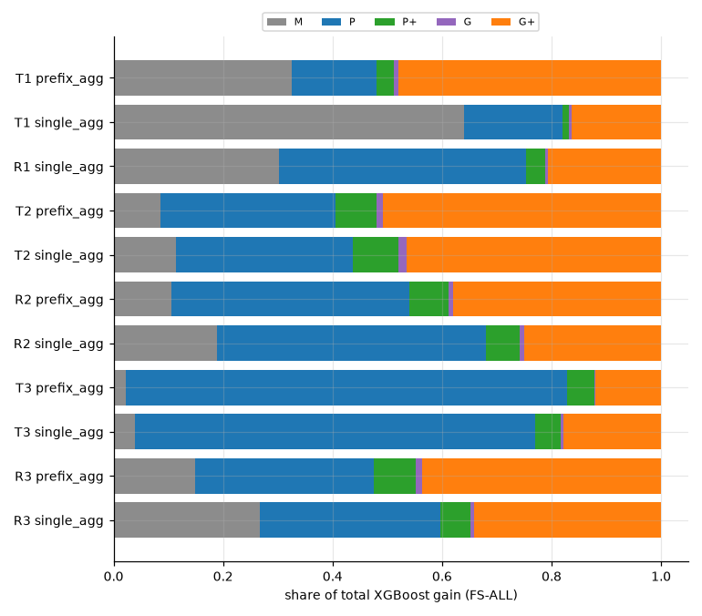
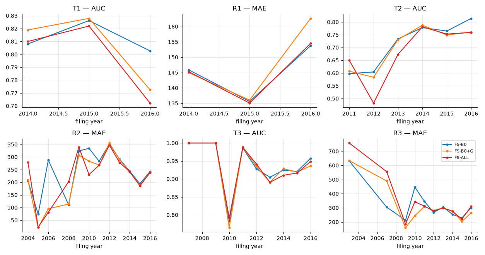
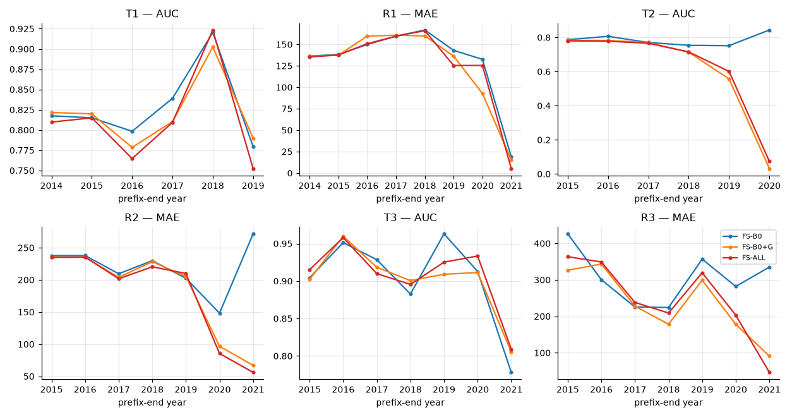

# Results — court-case predictive process monitoring

*Generated by `python -m court.report` on 2026-10-21 07:58 from `results` (77 runs.csv rows). Do not edit by hand.*

## 1. Summary

- Jobs: 62 of 72 Tier-1 fits done; 10 of 12 Tier-1 tuning jobs done; 3 jobs failed or timed out; 8 Tier-1 fits not run (yet).
- RQ1 T1: best AUC 0.825 (FS-MP, single_agg); paper baseline FS-B0 with the same method: 0.813.
- RQ1 T2: best AUC 0.808 (FS-B0, prefix_agg); paper baseline FS-B0 with the same method: 0.808.
- RQ2 R1: best MAE 144.3 days (FS-B0+P, single_agg) vs. 156.0 days for the per-length median baseline and 156.3 for the overall median.
- RQ2 R2: best MAE 220.3 days (FS-ALL, single_agg) vs. 256.8 days for the per-length median baseline and 257.5 for the overall median.
- RQ3, global extras (FS-B0+G − FS-B0, single_agg, 95% CI): T1 ΔAUC -0.011 [-0.014, -0.008]; R1 ΔMAE 4.0 [3.5, 4.5]; T2 ΔAUC -0.031 [-0.051, -0.010]; R2 ΔMAE -4.5 [-6.7, -2.6]; T3 ΔAUC -0.004 [-0.015, 0.007]; R3 ΔMAE -14.1 [-40.6, 11.4]. For AUC higher is better, for MAE lower is better.
- Same comparison restricted to test prefixes ending on or before 2016-12-31 (RD-26; G drift, section 8): T1 ΔAUC -0.008 [-0.011, -0.005]; R1 ΔMAE 4.4 [3.8, 5.0]; T2 ΔAUC -0.020 [-0.042, 0.001]; R2 ΔMAE -2.6 [-4.6, -0.6]; T3 ΔAUC 0.002 [-0.017, 0.020]; R3 ΔMAE 5.5 [-44.8, 46.7].
- Flags: 3 tuning job(s) hit the time cap (court_p1_reg__single_agg: done/timeout_halved;train_frac=0.5, court_p2_reg__single_agg: timeout/timeout_halved, court_p1_reg__prefix_agg: done/timeout_halved;train_frac=0.5); 8 fit(s) used default XGBoost params because tuning did not finish.

## 2. Data and cleaning

Source: `data/processed/data_report.json` (generated 2026-10-21 02:27 IDT) and `docs/data_report.md`.

**Inputs (MD5 checked at ingest)**

| File | Bytes | Lines (wc -l) | MD5 | OK |
|---|---|---|---|---|
| df_event_log.csv | 2,868,742,483 | 4,811,484 | `0f18ebeb01d366898a29896d69e45091` | True |
| case_level_df.csv | 67,255,833 | 155,525 | `97951dac7164a31a38e617503216c57a` | True |
| phases_event_log_cln.csv | 87,558,837 | 385,759 | `fced1e192da99a5dec2adff4e1542e89` | True |

**Cleaning counts**

| Step | Count |
|---|---|
| Event-log rows (full log) | 4,811,483 |
| Event rows of case-table cases | 4,237,231 |
| Cases in case table | 155,525 |
| Cases whose duplicate sum ≠ total_activity_count | 0 |
| D1 cases (all / in window) | 1,431 / 1,037 |
| D2 cases (all / in window) | 90 / 83 |
| D3 cases dropped (all / in window) | 50 / 47 |
| D4 cases (all / in window) | 582 / 501 |
| Cases after D3 (used for global features) | 155,475 |
| D5 window cases, before → after D3 | 128,532 → 128,485 |
| D2 phase-1 exit moved to trial start (RD-18), window | 80 |
| Phase-1 segments built / dropped empty (D7) | 128,485 / 875 |
| Phase-2 segments built / dropped empty (D7) | 60,424 / 12 |
| Phase-3 segments built / dropped empty (D7) | 2,497 / 13 |

**Segments per phase**

| Phase | Segments | Trace rows | In-phase rows (prefixes) | Label rate (moved on) | In-phase length q50 | q90 | q90 positives |
|---|---|---|---|---|---|---|---|
| p1 | 127,610 | 1,498,497 | 1,498,497 | 0.467 | 7 | 25 | 26 |
| p2 | 60,412 | 2,491,716 | 1,803,116 | 0.040 | 18 | 67 | 147 |
| p3 | 2,484 | 331,873 | 113,050 | 0.649 | 30 | 95 | 107 |


## 3. Protocol and deviations from the paper

Settings read from `configs/experiments.yaml`:

| Setting | Value |
|---|---|
| Tasks | T1 = `court_p1_clf`, R1 = `court_p1_reg`, T2 = `court_p2_clf`, R2 = `court_p2_reg`, T3 = `court_p3_clf`, R3 = `court_p3_reg` |
| Feature sets | FS-M, FS-MP, FS-B0, FS-B0+P, FS-B0+G, FS-ALL |
| Tiers | tier1a: single_agg × xgboost; tier1b: prefix_agg × xgboost; tier2: state_agg,cluster_agg,single_laststate × xgboost |
| Split | strict temporal (`split_data_strict`), 80% train / 20% test by first in-phase event |
| Tuning | TPE, 10 iterations, 3-fold CV, ≤ 20,000 training segments, CV gap 3, on FS-ALL; reused for the other FS |
| Prefixes | in-phase lengths j = 1, 1+g, … ≤ L; L = min(40, q90 in-phase length); train gap g = 3, test gap 1 |
| Time caps | tuning 20 min, final fit 10 min; over the cap: rerun on half the training segments, then flagged |
| XGBoost threads | 8 |
| Bootstrap | 1000 paired resamples of test segments, seed 22, 95% percentile CI |

**Deviations from the paper's protocol (by design, PLAN.md §4)**

- Prefixes are cut only inside the current phase (C6, D9); traces still start at filing, so the aggregation covers the whole case so far.
- Regression tasks R1–R3 replace the outcome label (C1–C5): XGBRegressor on log1p(days), MAE loss.
- Max prefix length L uses the in-phase length; training gap g = 3 instead of 1 (C7, paper RQ3.3 setting).
- Tuning budget reduced to 10 TPE iterations on ≤ 20,000 segments, tuned on FS-ALL only (8-hour budget).
- Tuning CV uses random 3-fold splits inside the training period, as upstream does, not time-ordered folds (RD-27).
- Test prefixes ending after 2016-12-31 are kept in the main tables; section 8.1 reports the restricted evaluation (RD-26).
- Only `single_agg` and `prefix_agg` with XGBoost in Tier 1; KNN, index-based, SVM, LSTM out of scope (D12).

**Run decisions** (all entries of `RUN_DECISIONS.md`)

| ID | Decision | Choice | Why |
|---|---|---|---|
| RD-01 | Interface between WS1 and WS3 | `court/SCHEMA.md`, fixed at bootstrap | lets A2 and A3 work in parallel without guessing column names |
| RD-02 | FS-MP contents ("M + P, no global") | M + P + P+ | PLAN.md §1.1 defines the Pre-phase view as including P+; FS-MP is the "intra-case only" set |
| RD-03 | Who registers court tasks in `experiments/dataset_confs.py` (WS1 step 8) | the second | A2 must not touch upstream code (PLAN.md §6); avoids conflicts with A1's compat commit |
| RD-04 | Agent isolation | worktrees `../worktrees/wt-{port,data,pipeline}` on branches `ws-*`; all share the main repo's `data/` via symlink | parallel work without checkout clashes; one copy of the large data |
| RD-05 | When A3 starts | start now, phased | saves ~1h of the 8h budget; no merge conflicts because upstream files are edited only after A1's compat commit is merged |
| RD-06 | "Open at t" for global features | filed ≤ t < terminated (state at end of day t), always excluding the case itself | day-level dates; a case terminated on t is no longer open |
| RD-07 | Phase fixes inside the global features | fixed dates (D4 phase-2 dates blanked); D3 cases excluded from global counts | same phase definition everywhere |
| RD-08 | Judge-history median with no prior closures | 0 (cases closed strictly before t only) | no leakage, XGBoost-safe; G_judge_* also 0 when `District_Judge` is missing |
| RD-09 | `Defendants_pending_counts`, `unique_*_judge_count` | excluded entirely | look like end-of-case values (conservative, extends D8) |
| RD-10 | Rare-level threshold scope | per phase file (static cols counted per segment, `judge` per event row) | each phase file is its own dataset, as upstream |
| RD-11 | `P_attr_duplicates` | count (view P) | it is a collapse count, not a flag |
| RD-12 | `PP_prev_phase_days_1/2` | same columns everywhere, 0 where not applicable | one `court_columns.json` for all phases |
| RD-13 | 875 phase-1 segments (all positive) with no event strictly before exit | drop and count | D7 rule; noted as a small selection effect in limitations |
| RD-14 | MD5 check scope at ingest | event-log MD5 + line count; case-table MD5 only (no trailing newline) | the 155,525 `wc -l` count is an artifact of the missing newline |
| RD-15 | XGBoost defaults that changed since the paper (tree_method, base_score) | keep current defaults | paper's search space unchanged; `hist` is required for 1–2M-row training sets in the 8h budget; P4 skipped, so no published-AUC target to match. Expect small differences vs the paper |
| RD-16 | Upstream bug: `experiments.py` crashes when a test bucket has no training prefixes | keep in compat (behaviour unchanged); court runner handles empty buckets itself | WS2 must not change behaviour |
| RD-17 | TPE seed | fixed seed 22 in court tuning (`HYPEROPT_FMIN_SEED` / `rstate`) | reproducible results |
| RD-18 | D2 phase-1 exit date | `phase3_entry_date` | D2: phase 2 has zero length, so phase 1 ends when trial starts; the raw date leaked trial/verdict events and the R3 target (G2 blocker) |
| RD-19 | Self-counting in `filed_last30/90`, `net_flow` | exclude self | consistent with RD-06 |
| RD-20 | `PP_n_distinct_judges` over all judges listed on an event | all listed, documented | uses only information known at the event |
| RD-21 | CV prefix gap during tuning | 3; the 20k-segment tuning cap is an evenly spaced time-ordered sample | fits the 20-min tuning cap |
| RD-22 | Same-day event order | upstream sort | dates are day-level, so there is no true within-day order; keeps fast path = upstream exactly |
| RD-23 | Start Tier 1a while A4 runs the G4 leakage review | start now | the review is read-only; ~30 min saved; any G4 blocker → delete `results/` and rerun |
| RD-24 | Tuning over the 20-min cap (p2_reg single_agg after halving; p1_reg halved) | per the time-cap rule: halve once, then XGBoost default params, flagged | 8h budget; flagged in results.md |
| RD-25 | Lost orchestration time (usage limit 02:51–05:40) | keep the handoff at 09:49; Tier 2 runs only if time is left | PLAN.md §6 rule 4: partial result beats a late one |
| RD-26 | Handling G-feature drift (court counts collapse after 2018: only closed cases in the case table) | post-hoc restricted evaluation from saved predictions (no retraining) + report as is, with the artifact named in limitations | fits the remaining budget; separates the data artifact from real drift; detrended/relative G features are listed as a next step |
| RD-27 | Tuning CV uses random folds inside train (upstream design) | keep, documented as a deviation risk (CV AUC 0.857 vs test 0.792 for T1) | changing it now would invalidate Tier 1 |
| RD-28 | Tier-1b cut (PLAN §6 rule 4, decided early because the full Tier 1b projected to ~08:45 > 08:04) | phase 1 and phase 3: all 6 FS; phase 2 (largest data, 40 buckets): FS-B0 and FS-ALL only; R2 prefix_agg uses XGBoost default params without tuning, like R2 single_agg (whose tuning timed out) | keeps all three RQ3 comparisons on phases 1 and 3 and the headline FS-ALL vs FS-B0 comparison on phase 2; fits by ~07:35 |
| RD-29 | R1 prefix_agg FS-B0+G and FS-ALL timed out twice (10-min cap, full and half sample) | report as timeout; the RQ3 comparison for R1 uses single_agg | rerunning both would take ≥ 40 min of the last 1h55 needed for G6 and handoff |


## 4. RQ1 — phase-transition classification (T1–T3)

AUC is pooled over all test prefixes (prefix-weighted, as in the paper); F1 at threshold 0.5; PR-AUC = average precision. T3 is secondary (D11).

| Task | Method | FS | AUC | F1@0.5 | PR-AUC | Test prefixes | Params | Flags / status |
|---|---|---|---|---|---|---|---|---|
| T1 | single_agg | FS-M | 0.744 | 0.614 | 0.720 | 248,411 | tuned |  |
| T1 | single_agg | FS-MP | 0.825 | 0.678 | 0.794 | 248,411 | tuned |  |
| T1 | single_agg | FS-B0 | 0.813 | 0.673 | 0.780 | 248,411 | tuned |  |
| T1 | single_agg | FS-B0+P | 0.812 | 0.670 | 0.781 | 248,411 | tuned |  |
| T1 | single_agg | FS-B0+G | 0.802 | 0.657 | 0.779 | 248,411 | tuned |  |
| T1 | single_agg | FS-ALL | 0.792 | 0.658 | 0.774 | 248,411 | tuned |  |
| T1 | prefix_agg | FS-M | 0.783 | 0.637 | 0.756 | 248,411 | tuned |  |
| T1 | prefix_agg | FS-MP | 0.823 | 0.653 | 0.793 | 248,411 | tuned |  |
| T1 | prefix_agg | FS-B0 | 0.792 | 0.630 | 0.762 | 248,411 | tuned |  |
| T1 | prefix_agg | FS-B0+P | 0.794 | 0.629 | 0.761 | 248,411 | tuned |  |
| T1 | prefix_agg | FS-B0+G | 0.782 | 0.593 | 0.762 | 248,411 | tuned |  |
| T1 | prefix_agg | FS-ALL | 0.782 | 0.590 | 0.761 | 248,411 | tuned |  |
| T2 | single_agg | FS-M | 0.719 | 0.029 | 0.112 | 201,322 | tuned |  |
| T2 | single_agg | FS-MP | 0.797 | 0.202 | 0.277 | 201,322 | tuned |  |
| T2 | single_agg | FS-B0 | 0.788 | 0.168 | 0.265 | 201,322 | tuned |  |
| T2 | single_agg | FS-B0+P | 0.786 | 0.185 | 0.267 | 201,322 | tuned |  |
| T2 | single_agg | FS-B0+G | 0.756 | 0.043 | 0.240 | 201,322 | tuned |  |
| T2 | single_agg | FS-ALL | 0.753 | 0.028 | 0.246 | 201,322 | tuned |  |
| T2 | prefix_agg | FS-M | – | – | – | – | tuned | not run: cut by RD-28 (8h budget) |
| T2 | prefix_agg | FS-MP | – | – | – | – | tuned | not run: cut by RD-28 (8h budget) |
| T2 | prefix_agg | FS-B0 | 0.808 | 0.170 | 0.273 | 201,322 | tuned |  |
| T2 | prefix_agg | FS-B0+P | – | – | – | – | tuned | not run: cut by RD-28 (8h budget) |
| T2 | prefix_agg | FS-B0+G | – | – | – | – | tuned | not run: cut by RD-28 (8h budget) |
| T2 | prefix_agg | FS-ALL | 0.793 | 0.110 | 0.269 | 201,322 | tuned |  |
| T3 | single_agg | FS-M | 0.722 | 0.818 | 0.882 | 13,270 | tuned |  |
| T3 | single_agg | FS-MP | 0.930 | 0.930 | 0.975 | 13,270 | tuned |  |
| T3 | single_agg | FS-B0 | 0.928 | 0.925 | 0.974 | 13,270 | tuned |  |
| T3 | single_agg | FS-B0+P | 0.930 | 0.928 | 0.975 | 13,270 | tuned |  |
| T3 | single_agg | FS-B0+G | 0.924 | 0.925 | 0.974 | 13,270 | tuned |  |
| T3 | single_agg | FS-ALL | 0.923 | 0.930 | 0.973 | 13,270 | tuned |  |
| T3 | prefix_agg | FS-M | 0.730 | 0.839 | 0.876 | 13,270 | tuned |  |
| T3 | prefix_agg | FS-MP | 0.916 | 0.935 | 0.953 | 13,270 | tuned |  |
| T3 | prefix_agg | FS-B0 | 0.912 | 0.933 | 0.952 | 13,270 | tuned |  |
| T3 | prefix_agg | FS-B0+P | 0.915 | 0.934 | 0.953 | 13,270 | tuned |  |
| T3 | prefix_agg | FS-B0+G | 0.904 | 0.933 | 0.949 | 13,270 | tuned |  |
| T3 | prefix_agg | FS-ALL | 0.910 | 0.934 | 0.954 | 13,270 | tuned |  |





## 5. RQ2 — time remaining in the phase (R1–R3)

MAE and median absolute error in days; R² on the log1p scale. Baselines (C13): training median of remaining days overall, and per in-phase prefix length.

| Task | Method | FS | MAE | MedAE | R² (log) | Baseline MAE (overall median) | Baseline MAE (per-length median) | Test prefixes | Params | Flags / status |
|---|---|---|---|---|---|---|---|---|---|---|
| R1 | single_agg | FS-M | 151.5 | 76.8 | 0.049 | 156.3 | 156.0 | 245,924 | tuned (timeout_halved;train_frac=0.5) |  |
| R1 | single_agg | FS-MP | 144.7 | 71.5 | 0.181 | 156.3 | 156.0 | 245,924 | tuned (timeout_halved;train_frac=0.5) |  |
| R1 | single_agg | FS-B0 | 145.5 | 70.4 | 0.171 | 156.3 | 156.0 | 245,924 | tuned (timeout_halved;train_frac=0.5) |  |
| R1 | single_agg | FS-B0+P | 144.3 | 70.1 | 0.182 | 156.3 | 156.0 | 245,924 | tuned (timeout_halved;train_frac=0.5) |  |
| R1 | single_agg | FS-B0+G | 149.5 | 69.4 | 0.154 | 156.3 | 156.0 | 245,924 | tuned (timeout_halved;train_frac=0.5) |  |
| R1 | single_agg | FS-ALL | 145.5 | 66.9 | 0.169 | 156.3 | 156.0 | 245,924 | tuned (timeout_halved;train_frac=0.5) |  |
| R1 | prefix_agg | FS-M | 149.8 | 73.7 | 0.071 | 156.3 | 156.0 | 245,924 | tuned (timeout_halved;train_frac=0.5) |  |
| R1 | prefix_agg | FS-MP | 147.2 | 70.7 | 0.142 | 156.3 | 156.0 | 245,924 | tuned (timeout_halved;train_frac=0.5) |  |
| R1 | prefix_agg | FS-B0 | 148.2 | 70.2 | 0.135 | 156.3 | 156.0 | 245,924 | tuned (timeout_halved;train_frac=0.5) |  |
| R1 | prefix_agg | FS-B0+P | 148.6 | 71.0 | 0.131 | 156.3 | 156.0 | 245,924 | tuned (timeout_halved;train_frac=0.5) |  |
| R1 | prefix_agg | FS-B0+G | – | – | – | – | – | – | tuned (timeout_halved;train_frac=0.5) | timeout: timeout_halved |
| R1 | prefix_agg | FS-ALL | – | – | – | – | – | – | tuned (timeout_halved;train_frac=0.5) | timeout: timeout_halved |
| R2 | single_agg | FS-M | 278.2 | 200.8 | -0.149 | 257.5 | 256.8 | 201,322 | tuning timeout (timeout_halved) → default params | default_params |
| R2 | single_agg | FS-MP | 227.2 | 159.2 | 0.234 | 257.5 | 256.8 | 201,322 | tuning timeout (timeout_halved) → default params | default_params |
| R2 | single_agg | FS-B0 | 226.2 | 157.1 | 0.232 | 257.5 | 256.8 | 201,322 | tuning timeout (timeout_halved) → default params | default_params |
| R2 | single_agg | FS-B0+P | 226.6 | 158.7 | 0.227 | 257.5 | 256.8 | 201,322 | tuning timeout (timeout_halved) → default params | default_params |
| R2 | single_agg | FS-B0+G | 221.7 | 148.6 | 0.197 | 257.5 | 256.8 | 201,322 | tuning timeout (timeout_halved) → default params | default_params |
| R2 | single_agg | FS-ALL | 220.3 | 147.1 | 0.233 | 257.5 | 256.8 | 201,322 | tuning timeout (timeout_halved) → default params | default_params |
| R2 | prefix_agg | FS-M | – | – | – | – | – | – | tuning not run | not run: cut by RD-28 (8h budget) |
| R2 | prefix_agg | FS-MP | – | – | – | – | – | – | tuning not run | not run: cut by RD-28 (8h budget) |
| R2 | prefix_agg | FS-B0 | 228.7 | 163.5 | 0.204 | 257.5 | 256.8 | 201,322 | tuning not run | default_params |
| R2 | prefix_agg | FS-B0+P | – | – | – | – | – | – | tuning not run | not run: cut by RD-28 (8h budget) |
| R2 | prefix_agg | FS-B0+G | – | – | – | – | – | – | tuning not run | not run: cut by RD-28 (8h budget) |
| R2 | prefix_agg | FS-ALL | 228.4 | 152.6 | 0.213 | 257.5 | 256.8 | 201,322 | tuning not run | default_params |
| R3 | single_agg | FS-M | 384.3 | 229.4 | -0.256 | 294.3 | 297.1 | 13,270 | tuned |  |
| R3 | single_agg | FS-MP | 278.5 | 197.1 | -0.058 | 294.3 | 297.1 | 13,270 | tuned |  |
| R3 | single_agg | FS-B0 | 283.5 | 206.3 | -0.114 | 294.3 | 297.1 | 13,270 | tuned |  |
| R3 | single_agg | FS-B0+P | 277.6 | 201.7 | -0.097 | 294.3 | 297.1 | 13,270 | tuned |  |
| R3 | single_agg | FS-B0+G | 269.4 | 185.5 | -0.158 | 294.3 | 297.1 | 13,270 | tuned |  |
| R3 | single_agg | FS-ALL | 285.7 | 196.3 | -0.335 | 294.3 | 297.1 | 13,270 | tuned |  |
| R3 | prefix_agg | FS-M | 427.1 | 270.4 | -0.337 | 294.3 | 297.1 | 13,270 | tuned |  |
| R3 | prefix_agg | FS-MP | 285.3 | 217.6 | -0.053 | 294.3 | 297.1 | 13,270 | tuned |  |
| R3 | prefix_agg | FS-B0 | 270.4 | 206.1 | -0.011 | 294.3 | 297.1 | 13,270 | tuned |  |
| R3 | prefix_agg | FS-B0+P | 272.2 | 204.1 | -0.009 | 294.3 | 297.1 | 13,270 | tuned |  |
| R3 | prefix_agg | FS-B0+G | 255.7 | 185.8 | 0.023 | 294.3 | 297.1 | 13,270 | tuned |  |
| R3 | prefix_agg | FS-ALL | 258.2 | 184.3 | 0.030 | 294.3 | 297.1 | 13,270 | tuned |  |

Baseline curves in the plots are rebuilt from `data/processed` with the runner's split and prefix rules; consistency check of the overall-median baseline against `runs.csv`:

| Task | Rebuilt MAE (overall median) | runs.csv MAE (overall median) | Rebuilt MAE (per-length median) | Test prefixes |
|---|---|---|---|---|
| R1 | 156.31 | 156.31 | 155.97 | 245,924 |
| R2 | 257.49 | 257.49 | 256.83 | 201,322 |
| R3 | 294.31 | 294.31 | 297.14 | 13,270 |





## 6. RQ3 — ablation against the paper baseline FS-B0

Δ = metric(FS) − metric(FS-B0) on the same test prefixes; 95% CI from 1000 paired bootstrap resamples of test segments (C11). Classification: Δ AUC (positive = better than FS-B0). Regression: Δ MAE in days (negative = better than FS-B0). A CI that excludes 0 is marked *.

| Task | Method | FS | Metric | Δ vs FS-B0 | 95% CI | Test segments |
|---|---|---|---|---|---|---|
| T1 | single_agg | FS-M | ΔAUC | -0.069* | [-0.073, -0.065] | 25,522 |
| T1 | single_agg | FS-MP | ΔAUC | 0.012* | [0.011, 0.014] | 25,522 |
| T1 | single_agg | FS-B0+P | ΔAUC | -0.001 | [-0.002, 0.000] | 25,522 |
| T1 | single_agg | FS-B0+G | ΔAUC | -0.011* | [-0.014, -0.008] | 25,522 |
| T1 | single_agg | FS-ALL | ΔAUC | -0.020* | [-0.024, -0.017] | 25,522 |
| T1 | prefix_agg | FS-M | ΔAUC | -0.008* | [-0.012, -0.005] | 25,522 |
| T1 | prefix_agg | FS-MP | ΔAUC | 0.032* | [0.030, 0.033] | 25,522 |
| T1 | prefix_agg | FS-B0+P | ΔAUC | 0.002* | [0.002, 0.003] | 25,522 |
| T1 | prefix_agg | FS-B0+G | ΔAUC | -0.010* | [-0.011, -0.008] | 25,522 |
| T1 | prefix_agg | FS-ALL | ΔAUC | -0.010* | [-0.011, -0.008] | 25,522 |
| R1 | single_agg | FS-M | ΔMAE | 6.0* | [5.4, 6.7] | 25,522 |
| R1 | single_agg | FS-MP | ΔMAE | -0.8* | [-1.1, -0.4] | 25,522 |
| R1 | single_agg | FS-B0+P | ΔMAE | -1.1* | [-1.4, -0.9] | 25,522 |
| R1 | single_agg | FS-B0+G | ΔMAE | 4.0* | [3.5, 4.5] | 25,522 |
| R1 | single_agg | FS-ALL | ΔMAE | 0.0 | [-0.4, 0.5] | 25,522 |
| R1 | prefix_agg | FS-M | ΔMAE | 1.6* | [1.2, 2.0] | 25,522 |
| R1 | prefix_agg | FS-MP | ΔMAE | -1.0* | [-1.2, -0.8] | 25,522 |
| R1 | prefix_agg | FS-B0+P | ΔMAE | 0.3* | [0.3, 0.4] | 25,522 |
| T2 | single_agg | FS-M | ΔAUC | -0.069* | [-0.095, -0.042] | 12,083 |
| T2 | single_agg | FS-MP | ΔAUC | 0.009* | [0.000, 0.018] | 12,083 |
| T2 | single_agg | FS-B0+P | ΔAUC | -0.002 | [-0.008, 0.004] | 12,083 |
| T2 | single_agg | FS-B0+G | ΔAUC | -0.031* | [-0.051, -0.010] | 12,083 |
| T2 | single_agg | FS-ALL | ΔAUC | -0.034* | [-0.053, -0.013] | 12,083 |
| T2 | prefix_agg | FS-ALL | ΔAUC | -0.014* | [-0.027, -0.001] | 12,083 |
| R2 | single_agg | FS-M | ΔMAE | 52.0* | [48.4, 55.8] | 12,083 |
| R2 | single_agg | FS-MP | ΔMAE | 1.0 | [-0.3, 2.3] | 12,083 |
| R2 | single_agg | FS-B0+P | ΔMAE | 0.4 | [-0.6, 1.4] | 12,083 |
| R2 | single_agg | FS-B0+G | ΔMAE | -4.5* | [-6.7, -2.6] | 12,083 |
| R2 | single_agg | FS-ALL | ΔMAE | -6.0* | [-7.9, -4.1] | 12,083 |
| R2 | prefix_agg | FS-ALL | ΔMAE | -0.3 | [-2.4, 1.7] | 12,083 |
| T3 | single_agg | FS-M | ΔAUC | -0.206* | [-0.260, -0.156] | 497 |
| T3 | single_agg | FS-MP | ΔAUC | 0.002 | [-0.004, 0.007] | 497 |
| T3 | single_agg | FS-B0+P | ΔAUC | 0.003 | [-0.003, 0.009] | 497 |
| T3 | single_agg | FS-B0+G | ΔAUC | -0.004 | [-0.015, 0.007] | 497 |
| T3 | single_agg | FS-ALL | ΔAUC | -0.005 | [-0.018, 0.007] | 497 |
| T3 | prefix_agg | FS-M | ΔAUC | -0.182* | [-0.235, -0.134] | 497 |
| T3 | prefix_agg | FS-MP | ΔAUC | 0.004 | [-0.000, 0.009] | 497 |
| T3 | prefix_agg | FS-B0+P | ΔAUC | 0.002 | [-0.001, 0.007] | 497 |
| T3 | prefix_agg | FS-B0+G | ΔAUC | -0.008* | [-0.017, -0.000] | 497 |
| T3 | prefix_agg | FS-ALL | ΔAUC | -0.003 | [-0.011, 0.006] | 497 |
| R3 | single_agg | FS-M | ΔMAE | 100.8* | [59.4, 145.1] | 497 |
| R3 | single_agg | FS-MP | ΔMAE | -5.0 | [-27.0, 16.2] | 497 |
| R3 | single_agg | FS-B0+P | ΔMAE | -6.0 | [-21.5, 10.0] | 497 |
| R3 | single_agg | FS-B0+G | ΔMAE | -14.1 | [-40.6, 11.4] | 497 |
| R3 | single_agg | FS-ALL | ΔMAE | 2.2 | [-26.9, 29.4] | 497 |
| R3 | prefix_agg | FS-M | ΔMAE | 156.7* | [117.1, 199.3] | 497 |
| R3 | prefix_agg | FS-MP | ΔMAE | 14.8* | [6.9, 23.0] | 497 |
| R3 | prefix_agg | FS-B0+P | ΔMAE | 1.8 | [-3.1, 6.4] | 497 |
| R3 | prefix_agg | FS-B0+G | ΔMAE | -14.7* | [-25.0, -3.8] | 497 |
| R3 | prefix_agg | FS-ALL | ΔMAE | -12.2* | [-22.6, -1.8] | 497 |


**Importance by view** (C12): share of total XGBoost gain per view (M = meta, P = paper pre-phase, P+ = court pre-phase extras, G = `open_cases`, G+ = global extras).

| Task | Method | FS | M | P | P+ | G | G+ |
|---|---|---|---|---|---|---|---|
| T1 | prefix_agg | FS-M | 1.000 | – | – | – | – |
| T1 | prefix_agg | FS-MP | 0.496 | 0.403 | 0.101 | – | – |
| T1 | prefix_agg | FS-B0 | 0.485 | 0.419 | – | 0.096 | – |
| T1 | prefix_agg | FS-B0+P | 0.470 | 0.357 | 0.088 | 0.086 | – |
| T1 | prefix_agg | FS-B0+G | 0.328 | 0.164 | – | 0.010 | 0.498 |
| T1 | prefix_agg | FS-ALL | 0.326 | 0.155 | 0.031 | 0.009 | 0.479 |
| T1 | single_agg | FS-M | 1.000 | – | – | – | – |
| T1 | single_agg | FS-MP | 0.747 | 0.237 | 0.016 | – | – |
| T1 | single_agg | FS-B0 | 0.732 | 0.236 | – | 0.032 | – |
| T1 | single_agg | FS-B0+P | 0.739 | 0.217 | 0.013 | 0.031 | – |
| T1 | single_agg | FS-B0+G | 0.629 | 0.190 | – | 0.006 | 0.175 |
| T1 | single_agg | FS-ALL | 0.641 | 0.180 | 0.011 | 0.005 | 0.164 |
| R1 | prefix_agg | FS-M | 1.000 | – | – | – | – |
| R1 | prefix_agg | FS-MP | 0.192 | 0.639 | 0.169 | – | – |
| R1 | prefix_agg | FS-B0 | 0.186 | 0.671 | – | 0.143 | – |
| R1 | prefix_agg | FS-B0+P | 0.173 | 0.555 | 0.146 | 0.125 | – |
| R1 | single_agg | FS-M | 1.000 | – | – | – | – |
| R1 | single_agg | FS-MP | 0.388 | 0.559 | 0.053 | – | – |
| R1 | single_agg | FS-B0 | 0.379 | 0.574 | – | 0.047 | – |
| R1 | single_agg | FS-B0+P | 0.378 | 0.532 | 0.050 | 0.040 | – |
| R1 | single_agg | FS-B0+G | 0.307 | 0.476 | – | 0.009 | 0.209 |
| R1 | single_agg | FS-ALL | 0.302 | 0.452 | 0.034 | 0.006 | 0.206 |
| T2 | prefix_agg | FS-B0 | 0.136 | 0.777 | – | 0.087 | – |
| T2 | prefix_agg | FS-ALL | 0.085 | 0.320 | 0.075 | 0.012 | 0.508 |
| T2 | single_agg | FS-M | 1.000 | – | – | – | – |
| T2 | single_agg | FS-MP | 0.184 | 0.633 | 0.183 | – | – |
| T2 | single_agg | FS-B0 | 0.186 | 0.715 | – | 0.099 | – |
| T2 | single_agg | FS-B0+P | 0.177 | 0.569 | 0.171 | 0.083 | – |
| T2 | single_agg | FS-B0+G | 0.112 | 0.370 | – | 0.015 | 0.503 |
| T2 | single_agg | FS-ALL | 0.114 | 0.322 | 0.084 | 0.015 | 0.464 |
| R2 | prefix_agg | FS-B0 | 0.188 | 0.752 | – | 0.060 | – |
| R2 | prefix_agg | FS-ALL | 0.105 | 0.435 | 0.071 | 0.009 | 0.379 |
| R2 | single_agg | FS-M | 1.000 | – | – | – | – |
| R2 | single_agg | FS-MP | 0.267 | 0.653 | 0.080 | – | – |
| R2 | single_agg | FS-B0 | 0.277 | 0.668 | – | 0.055 | – |
| R2 | single_agg | FS-B0+P | 0.267 | 0.605 | 0.076 | 0.052 | – |
| R2 | single_agg | FS-B0+G | 0.191 | 0.534 | – | 0.010 | 0.264 |
| R2 | single_agg | FS-ALL | 0.189 | 0.491 | 0.061 | 0.009 | 0.250 |
| T3 | prefix_agg | FS-M | 1.000 | – | – | – | – |
| T3 | prefix_agg | FS-MP | 0.044 | 0.886 | 0.070 | – | – |
| T3 | prefix_agg | FS-B0 | 0.045 | 0.940 | – | 0.015 | – |
| T3 | prefix_agg | FS-B0+P | 0.044 | 0.875 | 0.070 | 0.010 | – |
| T3 | prefix_agg | FS-B0+G | 0.024 | 0.835 | – | 0.004 | 0.137 |
| T3 | prefix_agg | FS-ALL | 0.023 | 0.805 | 0.050 | 0.002 | 0.120 |
| T3 | single_agg | FS-M | 1.000 | – | – | – | – |
| T3 | single_agg | FS-MP | 0.055 | 0.858 | 0.087 | – | – |
| T3 | single_agg | FS-B0 | 0.055 | 0.917 | – | 0.029 | – |
| T3 | single_agg | FS-B0+P | 0.051 | 0.843 | 0.083 | 0.023 | – |
| T3 | single_agg | FS-B0+G | 0.040 | 0.757 | – | 0.004 | 0.199 |
| T3 | single_agg | FS-ALL | 0.039 | 0.730 | 0.047 | 0.005 | 0.179 |
| R3 | prefix_agg | FS-M | 1.000 | – | – | – | – |
| R3 | prefix_agg | FS-MP | 0.195 | 0.650 | 0.154 | – | – |
| R3 | prefix_agg | FS-B0 | 0.198 | 0.734 | – | 0.068 | – |
| R3 | prefix_agg | FS-B0+P | 0.198 | 0.603 | 0.140 | 0.059 | – |
| R3 | prefix_agg | FS-B0+G | 0.148 | 0.372 | – | 0.012 | 0.467 |
| R3 | prefix_agg | FS-ALL | 0.149 | 0.327 | 0.077 | 0.011 | 0.436 |
| R3 | single_agg | FS-M | 1.000 | – | – | – | – |
| R3 | single_agg | FS-MP | 0.277 | 0.620 | 0.103 | – | – |
| R3 | single_agg | FS-B0 | 0.297 | 0.649 | – | 0.054 | – |
| R3 | single_agg | FS-B0+P | 0.340 | 0.517 | 0.096 | 0.048 | – |
| R3 | single_agg | FS-B0+G | 0.263 | 0.387 | – | 0.010 | 0.340 |
| R3 | single_agg | FS-ALL | 0.267 | 0.330 | 0.054 | 0.007 | 0.341 |



**Global features under temporal drift.** The leakage review (`VERIFICATION.md`, G4 Check 9.3) found no misalignment behind the G+ results and attributes them to drift of the G columns between the train and test periods; tree ensembles cannot extrapolate beyond the training range. `verification/g4_results.json` holds the alignment checks but not the drift statistics, so the statistics below are recomputed by this report from `data/processed` with the runner's split (tables `g_drift_smd__p*.csv`, `g_drift_yearly__p*.csv`). Section 8.1 repeats the ablation on test prefixes ending on or before 2016-12-31.

- Phase 1, test vs. train in-phase rows (split at 2014-08-18): largest standardised mean differences `G_court_closed_last90` +1.7 SD (17% of test values above / 0% below the train range); `G_court_open_phase1` +1.7 SD (35% of test values above / 1% below the train range); `G_judge_filed_last30` +1.5 SD (6% of test values above / 0% below the train range); `open_cases` +1.5 SD (46% above the train max); 17 of 32 global columns shift by more than 1 SD.
- Phase 1, yearly mean of `open_cases` (court-wide): peaks at 14,839 in 2016 and falls to 126 in 2021 (right-censoring: the case table holds only closed cases).
- Phase 1, judge-level counts 2015 → 2016 (yearly means): `G_judge_filed_last30` 24.2 → 55.4 (×2.29); `G_judge_open_phase1` 190.6 → 273.8 (×1.44); `G_judge_open` 380.6 → 596.1 (×1.57).
- Phase 2, test vs. train in-phase rows (split at 2015-02-11): largest standardised mean differences `G_judge_open_same_phase` +2.6 SD (11% of test values above / 0% below the train range); `G_judge_open_phase2` +2.6 SD (11% of test values above / 0% below the train range); `G_judge_open_same_type` +2.1 SD (10% of test values above / 0% below the train range); `open_cases` +1.0 SD (44% above the train max); 15 of 32 global columns shift by more than 1 SD.
- Phase 2, yearly mean of `open_cases` (court-wide): peaks at 14,840 in 2016 and falls to 126 in 2021 (right-censoring: the case table holds only closed cases).
- Phase 2, judge-level counts 2015 → 2016 (yearly means): `G_judge_filed_last30` 22.4 → 43.4 (×1.94); `G_judge_open_phase2` 174.2 → 340.4 (×1.95); `G_judge_open` 364.4 → 599.5 (×1.65).
- Phase 3, test vs. train in-phase rows (split at 2015-06-10): largest standardised mean differences `G_judge_open_phase2` +3.0 SD (12% of test values above / 0% below the train range); `G_court_net_flow90` -2.8 SD (3% of test values above / 52% below the train range); `G_court_net_flow30` -2.1 SD (3% of test values above / 18% below the train range); `open_cases` +0.3 SD (34% above the train max); 9 of 32 global columns shift by more than 1 SD.
- Phase 3, yearly mean of `open_cases` (court-wide): peaks at 14,803 in 2016 and falls to 110 in 2021 (right-censoring: the case table holds only closed cases).
- Phase 3, judge-level counts 2015 → 2016 (yearly means): `G_judge_filed_last30` 28.7 → 45.3 (×1.58); `G_judge_open_phase3` 15.2 → 14.0 (×0.92); `G_judge_open` 440.2 → 597.9 (×1.36).

Yearly means of selected global columns, phase-1 in-phase rows:

| Year | open_cases | G_court_open_phase1 | G_judge_filed_last30 | G_judge_open |
|---|---|---|---|---|
| 2003 | 8,852 | 5,000 | 27.3 | 261.1 |
| 2004 | 10,200 | 5,290 | 23.1 | 292.8 |
| 2005 | 10,156 | 4,727 | 18.3 | 278.0 |
| 2006 | 10,134 | 4,327 | 17.3 | 269.4 |
| 2007 | 10,393 | 4,259 | 17.8 | 277.6 |
| 2008 | 10,807 | 4,372 | 18.5 | 291.2 |
| 2009 | 11,548 | 4,691 | 19.6 | 307.2 |
| 2010 | 12,257 | 4,914 | 19.7 | 313.5 |
| 2011 | 12,784 | 5,507 | 21.2 | 324.2 |
| 2012 | 13,702 | 6,265 | 23.9 | 355.4 |
| 2013 | 14,019 | 6,459 | 22.1 | 366.6 |
| 2014 | 13,843 | 6,594 | 23.1 | 358.2 |
| 2015 | 13,648 | 6,701 | 24.2 | 380.6 |
| 2016 | 14,839 | 6,785 | 55.4 | 596.1 |
| 2017 | 14,548 | 5,975 | 23.3 | 475.6 |
| 2018 | 12,374 | 4,923 | 20.9 | 411.0 |
| 2019 | 7,229 | 2,359 | 0.9 | 368.7 |
| 2020 | 2,276 | 335.1 | 0.0 | 155.4 |
| 2021 | 125.6 | 18.0 | 0.0 | 3.5 |

## 7. Tier 2 and Tier 3

- Not run: method needs the upstream bucketers (not wired into the court runner) — 54 job(s): `tune__court_p1_clf__state_agg__xgboost`, `tier2__court_p1_clf__state_agg__FS-B0__xgboost`, `tier2__court_p1_clf__state_agg__FS-ALL__xgboost`, `tune__court_p1_clf__cluster_agg__xgboost`, `tier2__court_p1_clf__cluster_agg__FS-B0__xgboost`, `tier2__court_p1_clf__cluster_agg__FS-ALL__xgboost`, ….
- Not run: not run: 8h budget and the 02:51–05:40 usage-limit pause (RD-25) — 2 job(s): `tier2__court_p1_clf__single_agg__FS-ALL+S__xgboost`, `tier2__court_p1_reg__single_agg__FS-ALL+S__xgboost`.

Tier 3: the drift check is in section 8. Logistic/linear regression learners: not run — not part of the configured tiers (`configs/experiments.yaml`).

## 8. Drift check — test performance by filing year

Computed from the saved Tier-1a predictions (single_agg) joined to `filing_year`; no retraining. The test set is the latest 20% of segments by phase entry, so the oldest filing years hold only long-running cases; read small-n years with care.

| Task | Metric | Filing year | Test segments | FS-B0 | FS-B0+G | FS-ALL |
|---|---|---|---|---|---|---|
| T1 | AUC | 2014 | 4,016 | 0.808 | 0.819 | 0.810 |
| T1 | AUC | 2015 | 9,399 | 0.826 | 0.828 | 0.822 |
| T1 | AUC | 2016 | 12,107 | 0.803 | 0.773 | 0.762 |
| R1 | MAE | 2014 | 4,016 | 145.9 | 145.0 | 145.3 |
| R1 | MAE | 2015 | 9,399 | 135.6 | 136.0 | 135.1 |
| R1 | MAE | 2016 | 12,107 | 153.7 | 162.6 | 154.5 |
| T2 | AUC | 2011 | 17 | 0.598 | 0.607 | 0.651 |
| T2 | AUC | 2012 | 48 | 0.604 | 0.583 | 0.482 |
| T2 | AUC | 2013 | 146 | 0.734 | 0.731 | 0.673 |
| T2 | AUC | 2014 | 1,363 | 0.778 | 0.787 | 0.781 |
| T2 | AUC | 2015 | 4,190 | 0.765 | 0.749 | 0.753 |
| T2 | AUC | 2016 | 6,300 | 0.814 | 0.761 | 0.759 |
| R2 | MAE | 2004 | 1 | 205.9 | 208.9 | 278.8 |
| R2 | MAE | 2005 | 1 | 74.0 | 20.6 | 23.1 |
| R2 | MAE | 2006 | 1 | 287.7 | 95.6 | 81.4 |
| R2 | MAE | 2008 | 5 | 110.6 | 113.9 | 202.7 |
| R2 | MAE | 2009 | 3 | 323.9 | 307.3 | 338.6 |
| R2 | MAE | 2010 | 8 | 334.2 | 283.6 | 230.4 |
| R2 | MAE | 2011 | 17 | 283.2 | 268.2 | 267.8 |
| R2 | MAE | 2012 | 48 | 351.5 | 355.3 | 346.7 |
| R2 | MAE | 2013 | 146 | 291.8 | 289.7 | 278.3 |
| R2 | MAE | 2014 | 1,363 | 244.1 | 240.2 | 241.9 |
| R2 | MAE | 2015 | 4,190 | 194.2 | 188.3 | 186.0 |
| R2 | MAE | 2016 | 6,300 | 242.6 | 238.9 | 237.7 |
| T3 | AUC | 2007 | 3 | 1.000 | 1.000 | 1.000 |
| T3 | AUC | 2009 | 6 | 1.000 | 1.000 | 1.000 |
| T3 | AUC | 2010 | 19 | 0.783 | 0.764 | 0.791 |
| T3 | AUC | 2011 | 25 | 0.986 | 0.988 | 0.988 |
| T3 | AUC | 2012 | 66 | 0.928 | 0.934 | 0.941 |
| T3 | AUC | 2013 | 77 | 0.905 | 0.891 | 0.890 |
| T3 | AUC | 2014 | 101 | 0.925 | 0.929 | 0.910 |
| T3 | AUC | 2015 | 89 | 0.921 | 0.919 | 0.916 |
| T3 | AUC | 2016 | 110 | 0.958 | 0.937 | 0.949 |
| R3 | MAE | 2003 | 1 | 632.1 | 634.0 | 758.4 |
| R3 | MAE | 2007 | 3 | 304.5 | 489.7 | 555.5 |
| R3 | MAE | 2009 | 6 | 212.8 | 159.7 | 184.7 |
| R3 | MAE | 2010 | 19 | 446.2 | 244.4 | 343.1 |
| R3 | MAE | 2011 | 25 | 347.2 | 309.2 | 312.7 |
| R3 | MAE | 2012 | 66 | 266.8 | 282.1 | 277.3 |
| R3 | MAE | 2013 | 77 | 305.1 | 300.0 | 299.4 |
| R3 | MAE | 2014 | 101 | 254.3 | 277.1 | 275.7 |
| R3 | MAE | 2015 | 89 | 228.8 | 203.0 | 220.1 |
| R3 | MAE | 2016 | 110 | 300.3 | 265.5 | 310.3 |



### 8.1 Evaluation restricted to prefixes ending on or before 2016-12-31 (RD-26)

Every finished Tier-1 job re-evaluated from its saved predictions, keeping only test prefixes whose prefix-end event is dated on or before 2016-12-31 (the end of the D5 filing window; later court-level counts are depleted because only closed cases are in the case table). The prefix-end date is the event at position `n_hist + prefix_len` of the segment in `data/processed/court_phase{k}.parquet` (`prefix_len` = in-phase length j). No retraining.

| Task | Method | FS | Metric | All test prefixes | Prefixes ≤ 2016-12-31 | Prefixes kept / all | Δ vs FS-B0, all [95% CI] | Δ vs FS-B0, ≤ 2016 [95% CI] |
|---|---|---|---|---|---|---|---|---|
| T1 | single_agg | FS-M | AUC | 0.744 | 0.751 | 221,123 / 248,411 | -0.069* [-0.073, -0.065] | -0.056* [-0.061, -0.053] |
| T1 | single_agg | FS-MP | AUC | 0.825 | 0.820 | 221,123 / 248,411 | 0.012* [0.011, 0.014] | 0.012* [0.011, 0.014] |
| T1 | single_agg | FS-B0 | AUC | 0.813 | 0.807 | 221,123 / 248,411 | – | – |
| T1 | single_agg | FS-B0+P | AUC | 0.812 | 0.807 | 221,123 / 248,411 | -0.001 [-0.002, 0.000] | -0.001 [-0.002, 0.000] |
| T1 | single_agg | FS-B0+G | AUC | 0.802 | 0.800 | 221,123 / 248,411 | -0.011* [-0.014, -0.008] | -0.008* [-0.011, -0.005] |
| T1 | single_agg | FS-ALL | AUC | 0.792 | 0.789 | 221,123 / 248,411 | -0.020* [-0.024, -0.017] | -0.018* [-0.022, -0.015] |
| T1 | prefix_agg | FS-M | AUC | 0.783 | 0.786 | 221,123 / 248,411 | -0.008* [-0.012, -0.005] | -0.001 [-0.005, 0.003] |
| T1 | prefix_agg | FS-MP | AUC | 0.823 | 0.818 | 221,123 / 248,411 | 0.032* [0.030, 0.033] | 0.031* [0.030, 0.033] |
| T1 | prefix_agg | FS-B0 | AUC | 0.792 | 0.786 | 221,123 / 248,411 | – | – |
| T1 | prefix_agg | FS-B0+P | AUC | 0.794 | 0.789 | 221,123 / 248,411 | 0.002* [0.002, 0.003] | 0.003* [0.002, 0.003] |
| T1 | prefix_agg | FS-B0+G | AUC | 0.782 | 0.779 | 221,123 / 248,411 | -0.010* [-0.011, -0.008] | -0.008* [-0.009, -0.006] |
| T1 | prefix_agg | FS-ALL | AUC | 0.782 | 0.779 | 221,123 / 248,411 | -0.010* [-0.011, -0.008] | -0.008* [-0.009, -0.006] |
| R1 | single_agg | FS-M | MAE | 151.5 | 149.1 | 219,483 / 245,924 | 6.0* [5.4, 6.7] | 5.4* [4.6, 6.1] |
| R1 | single_agg | FS-MP | MAE | 144.7 | 142.8 | 219,483 / 245,924 | -0.8* [-1.1, -0.4] | -1.0* [-1.3, -0.7] |
| R1 | single_agg | FS-B0 | MAE | 145.5 | 143.8 | 219,483 / 245,924 | – | – |
| R1 | single_agg | FS-B0+P | MAE | 144.3 | 142.3 | 219,483 / 245,924 | -1.1* [-1.4, -0.9] | -1.4* [-1.7, -1.2] |
| R1 | single_agg | FS-B0+G | MAE | 149.5 | 148.2 | 219,483 / 245,924 | 4.0* [3.5, 4.5] | 4.4* [3.8, 5.0] |
| R1 | single_agg | FS-ALL | MAE | 145.5 | 143.9 | 219,483 / 245,924 | 0.0 [-0.4, 0.5] | 0.1 [-0.4, 0.5] |
| R1 | prefix_agg | FS-M | MAE | 149.8 | 147.7 | 219,483 / 245,924 | 1.6* [1.2, 2.0] | 1.1* [0.6, 1.5] |
| R1 | prefix_agg | FS-MP | MAE | 147.2 | 145.7 | 219,483 / 245,924 | -1.0* [-1.2, -0.8] | -1.0* [-1.2, -0.8] |
| R1 | prefix_agg | FS-B0 | MAE | 148.2 | 146.7 | 219,483 / 245,924 | – | – |
| R1 | prefix_agg | FS-B0+P | MAE | 148.6 | 147.0 | 219,483 / 245,924 | 0.3* [0.3, 0.4] | 0.4* [0.3, 0.5] |
| T2 | single_agg | FS-M | AUC | 0.719 | 0.738 | 118,158 / 201,322 | -0.069* [-0.095, -0.042] | -0.062* [-0.090, -0.033] |
| T2 | single_agg | FS-MP | AUC | 0.797 | 0.804 | 118,158 / 201,322 | 0.009* [0.000, 0.018] | 0.005 [-0.004, 0.015] |
| T2 | single_agg | FS-B0 | AUC | 0.788 | 0.800 | 118,158 / 201,322 | – | – |
| T2 | single_agg | FS-B0+P | AUC | 0.786 | 0.797 | 118,158 / 201,322 | -0.002 [-0.008, 0.004] | -0.003 [-0.009, 0.004] |
| T2 | single_agg | FS-B0+G | AUC | 0.756 | 0.779 | 118,158 / 201,322 | -0.031* [-0.051, -0.010] | -0.020 [-0.042, 0.001] |
| T2 | single_agg | FS-ALL | AUC | 0.753 | 0.775 | 118,158 / 201,322 | -0.034* [-0.053, -0.013] | -0.024* [-0.044, -0.004] |
| T2 | prefix_agg | FS-B0 | AUC | 0.808 | 0.820 | 118,158 / 201,322 | – | – |
| T2 | prefix_agg | FS-ALL | AUC | 0.793 | 0.808 | 118,158 / 201,322 | -0.014* [-0.027, -0.001] | -0.012 [-0.025, 0.001] |
| R2 | single_agg | FS-M | MAE | 278.2 | 261.1 | 118,158 / 201,322 | 52.0* [48.4, 55.8] | 23.3* [18.8, 27.7] |
| R2 | single_agg | FS-MP | MAE | 227.2 | 238.0 | 118,158 / 201,322 | 1.0 [-0.3, 2.3] | 0.2 [-1.4, 1.9] |
| R2 | single_agg | FS-B0 | MAE | 226.2 | 237.8 | 118,158 / 201,322 | – | – |
| R2 | single_agg | FS-B0+P | MAE | 226.6 | 238.5 | 118,158 / 201,322 | 0.4 [-0.6, 1.4] | 0.7 [-0.4, 1.9] |
| R2 | single_agg | FS-B0+G | MAE | 221.7 | 235.2 | 118,158 / 201,322 | -4.5* [-6.7, -2.6] | -2.6* [-4.6, -0.6] |
| R2 | single_agg | FS-ALL | MAE | 220.3 | 235.4 | 118,158 / 201,322 | -6.0* [-7.9, -4.1] | -2.4* [-4.6, -0.3] |
| R2 | prefix_agg | FS-B0 | MAE | 228.7 | 236.3 | 118,158 / 201,322 | – | – |
| R2 | prefix_agg | FS-ALL | MAE | 228.4 | 242.1 | 118,158 / 201,322 | -0.3 [-2.4, 1.7] | 5.8* [3.6, 8.0] |
| T3 | single_agg | FS-M | AUC | 0.722 | 0.757 | 5,426 / 13,270 | -0.206* [-0.260, -0.156] | -0.184* [-0.266, -0.102] |
| T3 | single_agg | FS-MP | AUC | 0.930 | 0.945 | 5,426 / 13,270 | 0.002 [-0.004, 0.007] | 0.005 [-0.002, 0.011] |
| T3 | single_agg | FS-B0 | AUC | 0.928 | 0.940 | 5,426 / 13,270 | – | – |
| T3 | single_agg | FS-B0+P | AUC | 0.930 | 0.943 | 5,426 / 13,270 | 0.003 [-0.003, 0.009] | 0.003 [-0.004, 0.009] |
| T3 | single_agg | FS-B0+G | AUC | 0.924 | 0.943 | 5,426 / 13,270 | -0.004 [-0.015, 0.007] | 0.002 [-0.017, 0.020] |
| T3 | single_agg | FS-ALL | AUC | 0.923 | 0.944 | 5,426 / 13,270 | -0.005 [-0.018, 0.007] | 0.004 [-0.010, 0.020] |
| T3 | prefix_agg | FS-M | AUC | 0.730 | 0.759 | 5,426 / 13,270 | -0.182* [-0.235, -0.134] | -0.168* [-0.243, -0.095] |
| T3 | prefix_agg | FS-MP | AUC | 0.916 | 0.926 | 5,426 / 13,270 | 0.004 [-0.000, 0.009] | -0.000 [-0.005, 0.004] |
| T3 | prefix_agg | FS-B0 | AUC | 0.912 | 0.927 | 5,426 / 13,270 | – | – |
| T3 | prefix_agg | FS-B0+P | AUC | 0.915 | 0.927 | 5,426 / 13,270 | 0.002 [-0.001, 0.007] | 0.000 [-0.004, 0.004] |
| T3 | prefix_agg | FS-B0+G | AUC | 0.904 | 0.927 | 5,426 / 13,270 | -0.008* [-0.017, -0.000] | 0.001 [-0.006, 0.008] |
| T3 | prefix_agg | FS-ALL | AUC | 0.910 | 0.930 | 5,426 / 13,270 | -0.003 [-0.011, 0.006] | 0.004 [-0.003, 0.012] |
| R3 | single_agg | FS-M | MAE | 384.3 | 397.6 | 5,426 / 13,270 | 100.8* [59.4, 145.1] | 64.1* [2.5, 138.2] |
| R3 | single_agg | FS-MP | MAE | 278.5 | 329.3 | 5,426 / 13,270 | -5.0 [-27.0, 16.2] | -4.3 [-47.7, 35.6] |
| R3 | single_agg | FS-B0 | MAE | 283.5 | 333.6 | 5,426 / 13,270 | – | – |
| R3 | single_agg | FS-B0+P | MAE | 277.6 | 330.1 | 5,426 / 13,270 | -6.0 [-21.5, 10.0] | -3.5 [-38.2, 25.6] |
| R3 | single_agg | FS-B0+G | MAE | 269.4 | 339.0 | 5,426 / 13,270 | -14.1 [-40.6, 11.4] | 5.5 [-44.8, 46.7] |
| R3 | single_agg | FS-ALL | MAE | 285.7 | 352.9 | 5,426 / 13,270 | 2.2 [-26.9, 29.4] | 19.4 [-31.5, 61.7] |
| R3 | prefix_agg | FS-M | MAE | 427.1 | 429.4 | 5,426 / 13,270 | 156.7* [117.1, 199.3] | 104.2* [56.2, 163.8] |
| R3 | prefix_agg | FS-MP | MAE | 285.3 | 335.7 | 5,426 / 13,270 | 14.8* [6.9, 23.0] | 10.5 [-4.5, 27.3] |
| R3 | prefix_agg | FS-B0 | MAE | 270.4 | 325.2 | 5,426 / 13,270 | – | – |
| R3 | prefix_agg | FS-B0+P | MAE | 272.2 | 325.4 | 5,426 / 13,270 | 1.8 [-3.1, 6.4] | 0.1 [-8.5, 8.3] |
| R3 | prefix_agg | FS-B0+G | MAE | 255.7 | 320.7 | 5,426 / 13,270 | -14.7* [-25.0, -3.8] | -4.6 [-21.3, 9.7] |
| R3 | prefix_agg | FS-ALL | MAE | 258.2 | 323.8 | 5,426 / 13,270 | -12.2* [-22.6, -1.8] | -1.4 [-18.2, 14.7] |


Test metrics by the year of the prefix-end event (Tier 1a, single_agg; table `drift_by_prefix_end_year.csv`):



## 9. Runtime

| Tier | Jobs recorded | Runtime (min) |
|---|---|---|
|  | 1 | 20.0 |
| tier1a | 36 | 20.7 |
| tier1b | 28 | 69.6 |
| tune | 10 | 113.8 |
| **total** | 75 | 224.1 |

<details><summary>Per job</summary>

| Job | Status | Runtime (s) | Flags |
|---|---|---|---|
| tune__court_p1_clf__single_agg__xgboost | done | 503.1 |  |
| tier1a__court_p1_clf__single_agg__FS-M__xgboost | done | 8.0 |  |
| tier1a__court_p1_clf__single_agg__FS-MP__xgboost | done | 19.5 |  |
| tier1a__court_p1_clf__single_agg__FS-B0__xgboost | done | 18.8 |  |
| tier1a__court_p1_clf__single_agg__FS-B0+P__xgboost | done | 19.9 |  |
| tier1a__court_p1_clf__single_agg__FS-B0+G__xgboost | done | 31.9 |  |
| tier1a__court_p1_clf__single_agg__FS-ALL__xgboost | done | 34.2 |  |
| tune__court_p1_reg__single_agg__xgboost | done | 903.8 | timeout_halved;train_frac=0.5 |
| tier1a__court_p1_reg__single_agg__FS-M__xgboost | done | 7.8 |  |
| tier1a__court_p1_reg__single_agg__FS-MP__xgboost | done | 19.1 |  |
| tier1a__court_p1_reg__single_agg__FS-B0__xgboost | done | 18.3 |  |
| tier1a__court_p1_reg__single_agg__FS-B0+P__xgboost | done | 19.5 |  |
| tier1a__court_p1_reg__single_agg__FS-B0+G__xgboost | done | 31.6 |  |
| tier1a__court_p1_reg__single_agg__FS-ALL__xgboost | done | 34.1 |  |
| tune__court_p2_clf__single_agg__xgboost | done | 656.5 |  |
| tier1a__court_p2_clf__single_agg__FS-M__xgboost | done | 16.5 |  |
| tier1a__court_p2_clf__single_agg__FS-MP__xgboost | done | 102.2 |  |
| tier1a__court_p2_clf__single_agg__FS-B0__xgboost | done | 97.5 |  |
| tier1a__court_p2_clf__single_agg__FS-B0+P__xgboost | done | 107.3 |  |
| tier1a__court_p2_clf__single_agg__FS-B0+G__xgboost | done | 202.5 |  |
| tier1a__court_p2_clf__single_agg__FS-ALL__xgboost | done | 213.9 |  |
| tune__court_p2_reg__single_agg__xgboost | timeout | 1,200 | timeout_halved |
| tier1a__court_p2_reg__single_agg__FS-M__xgboost | done | 9.6 | default_params |
| tier1a__court_p2_reg__single_agg__FS-MP__xgboost | done | 28.3 | default_params |
| tier1a__court_p2_reg__single_agg__FS-B0__xgboost | done | 26.6 | default_params |
| tier1a__court_p2_reg__single_agg__FS-B0+P__xgboost | done | 28.8 | default_params |
| tier1a__court_p2_reg__single_agg__FS-B0+G__xgboost | done | 45.7 | default_params |
| tier1a__court_p2_reg__single_agg__FS-ALL__xgboost | done | 49.2 | default_params |
| tune__court_p3_clf__single_agg__xgboost | done | 86.4 |  |
| tier1a__court_p3_clf__single_agg__FS-M__xgboost | done | 2.1 |  |
| tier1a__court_p3_clf__single_agg__FS-MP__xgboost | done | 4.9 |  |
| tier1a__court_p3_clf__single_agg__FS-B0__xgboost | done | 4.7 |  |
| tier1a__court_p3_clf__single_agg__FS-B0+P__xgboost | done | 4.9 |  |
| tier1a__court_p3_clf__single_agg__FS-B0+G__xgboost | done | 8.2 |  |
| tier1a__court_p3_clf__single_agg__FS-ALL__xgboost | done | 8.1 |  |
| tune__court_p3_reg__single_agg__xgboost | done | 514.4 |  |
| tier1a__court_p3_reg__single_agg__FS-M__xgboost | done | 1.1 |  |
| tier1a__court_p3_reg__single_agg__FS-MP__xgboost | done | 2.7 |  |
| tier1a__court_p3_reg__single_agg__FS-B0__xgboost | done | 2.6 |  |
| tier1a__court_p3_reg__single_agg__FS-B0+P__xgboost | done | 2.7 |  |
| tier1a__court_p3_reg__single_agg__FS-B0+G__xgboost | done | 4.3 |  |
| tier1a__court_p3_reg__single_agg__FS-ALL__xgboost | done | 4.4 |  |
| tune__court_p1_clf__prefix_agg__xgboost | done | 654.5 |  |
| tier1b__court_p1_clf__prefix_agg__FS-M__xgboost | done | 33.6 |  |
| tier1b__court_p1_clf__prefix_agg__FS-MP__xgboost | done | 107.3 |  |
| tier1b__court_p1_clf__prefix_agg__FS-B0__xgboost | done | 107.3 |  |
| tier1b__court_p1_clf__prefix_agg__FS-B0+P__xgboost | done | 115.7 |  |
| tier1b__court_p1_clf__prefix_agg__FS-B0+G__xgboost | done | 353.3 |  |
| tier1b__court_p1_clf__prefix_agg__FS-ALL__xgboost | done | 363.2 |  |
| tune__court_p1_reg__prefix_agg__xgboost | done | 1,188 | timeout_halved;train_frac=0.5 |
| tier1b__court_p1_reg__prefix_agg__FS-M__xgboost | done | 43.3 |  |
| tier1b__court_p1_reg__prefix_agg__FS-MP__xgboost | done | 275.7 |  |
| tier1b__court_p1_reg__prefix_agg__FS-B0__xgboost | done | 272.0 |  |
| tier1b__court_p1_reg__prefix_agg__FS-B0+P__xgboost | done | 321.1 |  |
| tier1b__court_p1_reg__prefix_agg__FS-B0+G__xgboost | timeout | 600.1 | timeout_halved |
| tier1b__court_p1_reg__prefix_agg__FS-ALL__xgboost | timeout | 600.1 | timeout_halved |
| tune__court_p2_clf__prefix_agg__xgboost | done | 1,044 |  |
| tier1b__court_p2_clf__prefix_agg__FS-B0__xgboost | done | 136.2 |  |
| tier1b__court_p2_clf__prefix_agg__FS-ALL__xgboost | done | 301.4 |  |
| tier1b__court_p2_reg__prefix_agg__FS-B0__xgboost | done | 44.5 | default_params |
| tier1b__court_p2_reg__prefix_agg__FS-ALL__xgboost | done | 90.6 | default_params |
| tune__court_p3_clf__prefix_agg__xgboost | done | 229.9 |  |
| tier1b__court_p3_clf__prefix_agg__FS-M__xgboost | done | 12.3 |  |
| tier1b__court_p3_clf__prefix_agg__FS-MP__xgboost | done | 14.7 |  |
| tier1b__court_p3_clf__prefix_agg__FS-B0__xgboost | done | 13.9 |  |
| tier1b__court_p3_clf__prefix_agg__FS-B0+P__xgboost | done | 15.0 |  |
| tier1b__court_p3_clf__prefix_agg__FS-B0+G__xgboost | done | 22.7 |  |
| tier1b__court_p3_clf__prefix_agg__FS-ALL__xgboost | done | 24.0 |  |
| tune__court_p3_reg__prefix_agg__xgboost | done | 1,050 |  |
| tier1b__court_p3_reg__prefix_agg__FS-M__xgboost | done | 15.1 |  |
| tier1b__court_p3_reg__prefix_agg__FS-MP__xgboost | done | 44.0 |  |
| tier1b__court_p3_reg__prefix_agg__FS-B0__xgboost | done | 39.2 |  |
| tier1b__court_p3_reg__prefix_agg__FS-B0+P__xgboost | done | 44.6 |  |
| tier1b__court_p3_reg__prefix_agg__FS-B0+G__xgboost | done | 79.8 |  |
| tier1b__court_p3_reg__prefix_agg__FS-ALL__xgboost | done | 84.3 |  |

</details>

## 10. Limitations and open issues

From the data report:

- The global features use only the closed cases in the case table (155,525, minus 50 D3 cases). The 7,161 cases of the full log that were still open at extraction are missing, so open counts (and filed counts) are biased low, increasingly toward 2016.
- The case-table `District_Judge` (used for the judge-level G features and `M_District_Judge`) may be the judge at the end of the case (after reassignment), not the judge at time t.
- 875 phase-1 segments (all positives) have no in-phase event before the exit and are dropped (D7).

Run issues:

- `tune__court_p2_reg__single_agg__xgboost`: timeout (timeout_halved).
- `tier1b__court_p1_reg__prefix_agg__FS-B0+G__xgboost`: timeout (timeout_halved).
- `tier1b__court_p1_reg__prefix_agg__FS-ALL__xgboost`: timeout (timeout_halved).
- `tune__court_p1_reg__single_agg__xgboost`: finished with flags `timeout_halved;train_frac=0.5`.
- `tier1a__court_p2_reg__single_agg__FS-M__xgboost`: finished with flags `default_params`.
- `tier1a__court_p2_reg__single_agg__FS-MP__xgboost`: finished with flags `default_params`.
- `tier1a__court_p2_reg__single_agg__FS-B0__xgboost`: finished with flags `default_params`.
- `tier1a__court_p2_reg__single_agg__FS-B0+P__xgboost`: finished with flags `default_params`.
- `tier1a__court_p2_reg__single_agg__FS-B0+G__xgboost`: finished with flags `default_params`.
- `tier1a__court_p2_reg__single_agg__FS-ALL__xgboost`: finished with flags `default_params`.
- `tune__court_p1_reg__prefix_agg__xgboost`: finished with flags `timeout_halved;train_frac=0.5`.
- `tier1b__court_p2_reg__prefix_agg__FS-B0__xgboost`: finished with flags `default_params`.
- `tier1b__court_p2_reg__prefix_agg__FS-ALL__xgboost`: finished with flags `default_params`.
- 8 job(s) not run (cut by RD-28 (8h budget)), e.g. `tier1b__court_p2_clf__prefix_agg__FS-M__xgboost`.
- 54 job(s) not run (method needs the upstream bucketers (not wired into the court runner)), e.g. `tune__court_p1_clf__state_agg__xgboost`.
- 2 job(s) not run (not run: 8h budget and the 02:51–05:40 usage-limit pause (RD-25)), e.g. `tier2__court_p1_clf__single_agg__FS-ALL+S__xgboost`.
- 1 job(s) not run (skipped by RD-28; fits use XGBoost default params), e.g. `tune__court_p2_reg__prefix_agg__xgboost`.
- The upstream port was validated on a synthetic log only (P4 skipped: the paper's datasets were not provided), so there is no published-AUC reproduction check.
- G drift (VERIFICATION.md G4; details in section 6): phase 1: 17 of 32 global columns shift by more than 1 SD between train and test in-phase rows; phase 2: 15 of 32 global columns shift by more than 1 SD between train and test in-phase rows; phase 3: 9 of 32 global columns shift by more than 1 SD between train and test in-phase rows.
- The global (G/G+) features are non-stationary and partly a data artifact (closed-cases-only case table, judge-level break in 2016); RQ3 G conclusions should be read as 'G under temporal drift', see the restricted evaluation in section 8.1 (RD-26). Detrended or relative G features are a next step.
- Tuning CV uses random folds inside the training period, as upstream does (RD-27); it is optimistic and hides temporal drift (compare the tuning CV score in `runs.csv` with the test score).
- Hyperparameters were tuned on FS-ALL and reused for the other feature sets of the same task and method, which can favour FS-ALL.

## 11. Commands to reproduce

```
export PYTHONPATH=$PWD:$PWD/experiments
python -m court.run --config configs/experiments.yaml            # data → tuning → runs → report (resumable)
# or stage by stage:
python -m court.data_prep.build
python -m court.run_queue --config configs/experiments.yaml --tier tier1a --tier tier1b
python -m court.report --results-dir results --out results.md
python -m unittest discover -s tests
```
